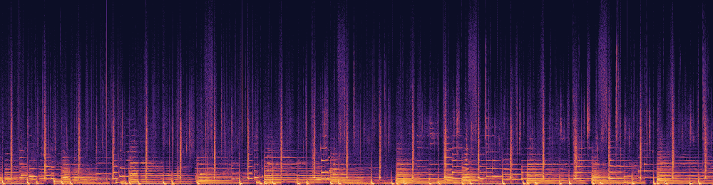

# Magenta RT 2 — 연주곡 만들기

PromBoard 커뮤니티 플러그인입니다. 캔버스에 **Magenta RT 2 연주곡** 노드 하나를 더합니다. 영어 스타일 글(예: `lo-fi hip hop, mellow piano`)을 이으면 그 느낌의 가사 없는 연주곡을 정한 길이(4초~5분)만큼 만들어 48kHz 스테레오 WAV 로 냅니다. Google DeepMind [Magenta RealTime 2](https://huggingface.co/google/magenta-realtime-2)를, 원본 JAX 판과 토큰 단위로 같다고 검증된 PyTorch 판([magenta-community](https://huggingface.co/magenta-community/magenta-realtime-2-small))으로 돌립니다.



스타일 글 `warm lo-fi hip hop with mellow piano and soft drums`, 판 small, 30초로 만든 곡의 스펙트로그램입니다. 일정한 간격의 세로줄이 드럼, 아래쪽 가로줄이 피아노 · 베이스 음입니다. 들어 보기: [lofi-30s.mp3](docs/lofi-30s.mp3?raw=true)(누르면 내려받습니다 — GitHub 화면은 소리를 재생하지 않습니다). 결과는 이 저장소의 `nodes/main.py` 를 PromBoard 앱(격리 실행)에서 그대로 돌린 것입니다(스타일 따르기 3, 다양성 1.3, 시드 0).

## 노드

- 입력: 스타일 글(영어 권장). 가사 · 목소리는 만들지 않습니다.
- 설정: 판(small · base), 길이(초, 4~300), 스타일 따르기(0~7, 기본 3), 다양성(기본 1.3), 시드.
- 원래 Magenta RT 는 실시간으로 이어 연주하는 모델이지만, 이 노드는 '길이를 정해 한 번에 만들기'입니다. 2초씩 이어 만들며 그 사이마다 진행률을 알리고 취소를 받습니다.

## 받는 것 · 크기

| 판 | 받는 크기 |
|---|---|
| small (230M, 기본) | 1.1GB |
| base (2.4B) | 9.8GB |

두 판 모두 스타일 글을 토큰으로 바꾸는 MusicCoCa(0.5GB)를 함께 받습니다. 고른 판만 받고, 파일마다 sha256 을 확인합니다. 가중치는 플러그인 zip 에 들어 있지 않습니다.

## 그래픽카드 메모리 · 걸린 시간 (실측)

RTX 4070 SUPER 12GB · Windows 11, 판 small, 30초 곡:

| 그래픽카드 메모리(이 실행이 더 쓴 몫) | 불러오기 | 만들기 | 전체 |
|---|---|---|---|
| 1.6GB | 31초 | 34.5초 | 71초 |

- 30초 곡을 34.5초에 만들었습니다(실시간에 가까운 속도).
- **미검증**: base 판(12GB 그래픽카드에서 돌려 보지 않았습니다), 30초가 아닌 길이.

## 라이선스 · 표기

- 플러그인 코드 Apache-2.0([LICENSE](LICENSE), [NOTICE](NOTICE)). 옮겨 온 PyTorch 모델 코드(`nodes/mrt2`)는 Google LLC 의 Apache-2.0 코드를 바꾸지 않고 그대로 넣었습니다.
- **가중치는 CC-BY-4.0** 입니다. 만든 곡이나 모델을 쓸 때 `Magenta RealTime 2 (Google DeepMind), CC-BY-4.0` 처럼 출처를 밝혀 주세요. 남의 저작권 등 권리를 침해하는 결과물을 만들지 않아야 하고(Google 이용 조건), 결과물에 대한 권리는 Google 이 주장하지 않습니다. 원문: [google/magenta-realtime-2](https://huggingface.co/google/magenta-realtime-2).
- 앱은 설치 때 이 조건을 보여 주고 확인을 받습니다.

## 설치

1. PromBoard → 플러그인 매니저 → **커뮤니티 플러그인** → 둘러보기에서 설치합니다.
2. 코드가 든 플러그인이라 **제한 모드**를 끄고 플러그인을 켭니다.
3. 처음 실행 전 실행 준비가 파이썬 패키지(앱이 고정한 torch 2.8.0 포함)와 고른 판의 가중치(small 1.6GB)를 받습니다.
4. 캔버스 빈 곳을 오른쪽 클릭하면 메뉴 맨 아래 플러그인 묶음에 **Magenta RT 2 연주곡**이 있습니다. 글 노드를 '스타일' 입력에 잇습니다.

## 플러그인 만드는 사람을 위한 메모

```
manifest.json            플러그인 정보 · 노드(입력 text, 출력 audio) · 판별 모델(requires.models[].when) · licenseNotice(CC-BY 표기)
nodes/main.py            NODES = {"music": 함수} — 스타일 글을 한 번 토큰으로 바꾸고, 상태(state)를 이어 받으며 50프레임(2초)씩 만든다
nodes/mrt2/              magenta-community/magenta-realtime-2-small 의 모델 코드(리비전 7037d99, 그대로). trust_remote_code 대신 직접 import
nodes/requirements-*.txt 운영체제별 해시 잠금 파일(torch 줄은 앱이 빼고 앱의 torch 2.8.0 을 먼저 깐다)
docs/                    이 README 의 그림 · 소리 · 만드는 스크립트. 플러그인 zip 에는 넣지 않는다(.gitattributes export-ignore)
```

- 스펙트로그램 다시 만들기: `python docs/scripts/spectrogram.py <곡.wav> docs/lofi-30s.png` (numpy · soundfile · Pillow), mp3 는 `ffmpeg -i <곡.wav> -b:a 128k docs/lofi-30s.mp3`.

---

## English

A PromBoard community plugin. It adds one **Magenta RT 2 연주곡** (instrumental music) node: connect an English style text (e.g. `lo-fi hip hop, mellow piano`) and it writes an instrumental track of a fixed length (4 seconds to 5 minutes) as a 48 kHz stereo WAV. It runs Google DeepMind [Magenta RealTime 2](https://huggingface.co/google/magenta-realtime-2) through the PyTorch port by [magenta-community](https://huggingface.co/magenta-community/magenta-realtime-2-small), verified token-for-token against the original JAX version.


Spectrogram of a 30-second track made from `warm lo-fi hip hop with mellow piano and soft drums` with the small model: the evenly spaced vertical lines are drums, the horizontal lines at the bottom are piano and bass notes. Listen: [lofi-30s.mp3](docs/lofi-30s.mp3?raw=true) (downloads the file — GitHub pages do not play audio). Produced by running this repository's `nodes/main.py` inside the PromBoard app (isolated run), style strength 3, temperature 1.3, seed 0.

- Settings: model (small, base), length in seconds (4–300), style strength (0–7, default 3), temperature (default 1.3), seed. No lyrics or vocals.
- Magenta RT is a real-time streaming model; this node instead makes the whole track at once, two seconds at a time, reporting progress and accepting cancel between chunks.
- Downloads: small (230M, default) 1.1 GB, base (2.4B) 9.8 GB, plus MusicCoCa (0.5 GB) for both. Only the chosen model is downloaded, pinned by sha256; nothing is in the plugin zip.
- Measured (RTX 4070 SUPER 12 GB · Windows 11, small, 30-second track): 1.6 GB of extra GPU memory, load 31 s, generation 34.5 s (close to real time), 71 s in total. **Not verified**: the base model and lengths other than 30 seconds.
- **Install**: PromBoard → Plugin Manager → **Community plugins** → Browse → install, turn off **Restricted mode** and enable the plugin. The first prepare downloads the Python packages (including the app's pinned torch 2.8.0) and the chosen model (1.6 GB for small). Right-click an empty spot on the canvas: the node is in the plugin group at the bottom of the menu; connect a text node to its "style" input.

The plugin texts in the app are Korean only for now — the plugin manifest takes a single language.

### License and attribution

Plugin code: Apache-2.0 ([LICENSE](LICENSE), [NOTICE](NOTICE)); the bundled PyTorch model code (`nodes/mrt2`) is Google LLC's Apache-2.0 code, unchanged. **The weights are CC-BY-4.0**: credit them as `Magenta RealTime 2 (Google DeepMind), CC-BY-4.0` when you use the model or what you make with it. Do not create output that infringes others' rights (Google's terms); Google claims no rights in your output. The app shows these conditions and asks for confirmation at install time.
